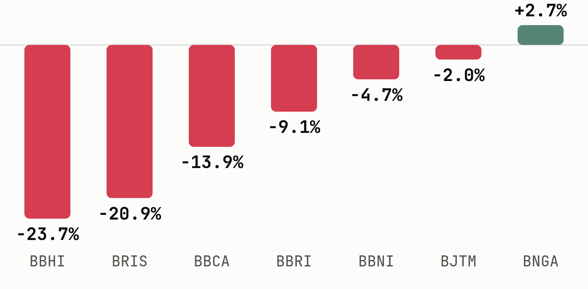

# Banks Fell 9.4% in a Week and Now Trade at a Five-Year Low of 8.0x Earnings

*Sectors Sector Spotlight, 22 October 2026. Data as of 21 October 2026.*

The 48 listed banks on IDX carry a combined market cap of IDR 2,075.32T and a median 2026 P/E of **8.0x**, the lowest of the five yearly readings sectors.app carries for the group. Their combined market cap fell **9.4%** over the past week and is down **30.9%** year-to-date. The week's trigger was MSCI's warning that Indonesia could be removed from its global indexes next year (Trading Economics, 16 Oct 2026), a day on which the Jakarta Composite closed down 11.57% and the finance index fell 8.98% (Databoks, 16 Oct 2026).

## The Median Bank P/E Is Nearly Half Its 2025 Level

| Year | Median P/E | Median P/B | Median P/S |
|---|---|---|---|
| 2022 | 15.1x | 0.98x | 4.42x |
| 2023 | 16.9x | 0.85x | 4.03x |
| 2024 | 16.2x | 0.81x | 3.43x |
| 2025 | 14.7x | 0.85x | 3.87x |
| **2026** | **8.0x** | **0.73x** | **2.17x** |

*Banks sub-sector historical valuation, sectors.app. 2026 is the current-year reading as of 21 Oct 2026.*

The market-cap-weighted P/E is **16.1x**, twice the 8.0x median. The four largest banks by market cap trade between 4.9x and 11.1x trailing earnings, below that weighted figure, so the gap points to smaller lenders with high multiples, among them Bank Permata ([**BNLI**](https://sectors.app/idx/bnli?utm_source=newsletter&utm_medium=email&utm_campaign=sector-spotlight_2026-10-22&utm_content=history&utm_term=bnli)) at 17.3x, Bank Jago ([**ARTO**](https://sectors.app/idx/arto?utm_source=newsletter&utm_medium=email&utm_campaign=sector-spotlight_2026-10-22&utm_content=history&utm_term=arto)) at 24.3x, Super Bank Indonesia ([**SUPA**](https://sectors.app/idx/supa?utm_source=newsletter&utm_medium=email&utm_campaign=sector-spotlight_2026-10-22&utm_content=history&utm_term=supa)) at 64.7x and Krom Bank Indonesia ([**BBSI**](https://sectors.app/idx/bbsi?utm_source=newsletter&utm_medium=email&utm_campaign=sector-spotlight_2026-10-22&utm_content=history&utm_term=bbsi)) at 68.2x (sectors.app).

## State-Owned and Regional Banks Hold the Cheap End

| Ticker | Company | P/E (ttm) | Market cap |
|---|---|---|---|
| [**BJTM**](https://sectors.app/idx/bjtm?utm_source=newsletter&utm_medium=email&utm_campaign=sector-spotlight_2026-10-22&utm_content=cheap-end&utm_term=bjtm) | Bank Pembangunan Daerah Jawa Timur | 2.9x | IDR 7.43T |
| [**BBTN**](https://sectors.app/idx/bbtn?utm_source=newsletter&utm_medium=email&utm_campaign=sector-spotlight_2026-10-22&utm_content=cheap-end&utm_term=bbtn) | Bank Tabungan Negara | 3.1x | IDR 13.06T |
| [**BJBR**](https://sectors.app/idx/bjbr?utm_source=newsletter&utm_medium=email&utm_campaign=sector-spotlight_2026-10-22&utm_content=cheap-end&utm_term=bjbr) | Bank Pembangunan Daerah Jawa Barat dan Banten | 3.3x | IDR 7.50T |
| [**BMRI**](https://sectors.app/idx/bmri?utm_source=newsletter&utm_medium=email&utm_campaign=sector-spotlight_2026-10-22&utm_content=cheap-end&utm_term=bmri) | Bank Mandiri | 4.9x | IDR 341.88T |
| [**NISP**](https://sectors.app/idx/nisp?utm_source=newsletter&utm_medium=email&utm_campaign=sector-spotlight_2026-10-22&utm_content=cheap-end&utm_term=nisp) | Bank OCBC NISP | 5.1x | IDR 26.46T |
| [**BBNI**](https://sectors.app/idx/bbni?utm_source=newsletter&utm_medium=email&utm_campaign=sector-spotlight_2026-10-22&utm_content=cheap-end&utm_term=bbni) | Bank Negara Indonesia | 5.8x | IDR 120.00T |
| [**PNBN**](https://sectors.app/idx/pnbn?utm_source=newsletter&utm_medium=email&utm_campaign=sector-spotlight_2026-10-22&utm_content=cheap-end&utm_term=pnbn) | Bank Pan Indonesia | 5.8x | IDR 17.52T |
| [**BRIS**](https://sectors.app/idx/bris?utm_source=newsletter&utm_medium=email&utm_campaign=sector-spotlight_2026-10-22&utm_content=cheap-end&utm_term=bris) | Bank Syariah Indonesia | 6.0x | IDR 47.49T |
| [**BTPS**](https://sectors.app/idx/btps?utm_source=newsletter&utm_medium=email&utm_campaign=sector-spotlight_2026-10-22&utm_content=cheap-end&utm_term=btps) | Bank BTPN Syariah | 6.2x | IDR 7.47T |
| [**BNGA**](https://sectors.app/idx/bnga?utm_source=newsletter&utm_medium=email&utm_campaign=sector-spotlight_2026-10-22&utm_content=cheap-end&utm_term=bnga) | Bank CIMB Niaga | 6.3x | IDR 42.94T |

*The ten lowest trailing P/Es among 25 banks above a IDR 3T market-cap floor with positive earnings, as of 21 Oct 2026, sectors.app.*

| Ticker | Company | P/E (ttm) | Market cap |
|---|---|---|---|
| [**BBSI**](https://sectors.app/idx/bbsi?utm_source=newsletter&utm_medium=email&utm_campaign=sector-spotlight_2026-10-22&utm_content=cheap-end&utm_term=bbsi) | Krom Bank Indonesia | 68.2x | IDR 13.02T |
| [**SUPA**](https://sectors.app/idx/supa?utm_source=newsletter&utm_medium=email&utm_campaign=sector-spotlight_2026-10-22&utm_content=cheap-end&utm_term=supa) | Super Bank Indonesia | 64.7x | IDR 11.81T |
| [**MAYA**](https://sectors.app/idx/maya?utm_source=newsletter&utm_medium=email&utm_campaign=sector-spotlight_2026-10-22&utm_content=cheap-end&utm_term=maya) | Bank Mayapada Internasional | 63.0x | IDR 4.25T |
| [**BSIM**](https://sectors.app/idx/bsim?utm_source=newsletter&utm_medium=email&utm_campaign=sector-spotlight_2026-10-22&utm_content=cheap-end&utm_term=bsim) | Bank Sinarmas | 49.7x | IDR 16.30T |
| [**BBMD**](https://sectors.app/idx/bbmd?utm_source=newsletter&utm_medium=email&utm_campaign=sector-spotlight_2026-10-22&utm_content=cheap-end&utm_term=bbmd) | Bank Mestika Dharma | 27.6x | IDR 8.30T |
| [**ARTO**](https://sectors.app/idx/arto?utm_source=newsletter&utm_medium=email&utm_campaign=sector-spotlight_2026-10-22&utm_content=cheap-end&utm_term=arto) | Bank Jago | 24.3x | IDR 8.23T |
| [**BBHI**](https://sectors.app/idx/bbhi?utm_source=newsletter&utm_medium=email&utm_campaign=sector-spotlight_2026-10-22&utm_content=cheap-end&utm_term=bbhi) | Allo Bank Indonesia | 21.5x | IDR 12.48T |

*The seven highest trailing P/Es among the same 25 banks, same floor and date, sectors.app.*

Five of the six lowest multiples belong to state-owned or regional-government lenders: [**BJTM**](https://sectors.app/idx/bjtm?utm_source=newsletter&utm_medium=email&utm_campaign=sector-spotlight_2026-10-22&utm_content=cheap-end&utm_term=bjtm), [**BBTN**](https://sectors.app/idx/bbtn?utm_source=newsletter&utm_medium=email&utm_campaign=sector-spotlight_2026-10-22&utm_content=cheap-end&utm_term=bbtn), [**BJBR**](https://sectors.app/idx/bjbr?utm_source=newsletter&utm_medium=email&utm_campaign=sector-spotlight_2026-10-22&utm_content=cheap-end&utm_term=bjbr), [**BMRI**](https://sectors.app/idx/bmri?utm_source=newsletter&utm_medium=email&utm_campaign=sector-spotlight_2026-10-22&utm_content=cheap-end&utm_term=bmri) and [**BBNI**](https://sectors.app/idx/bbni?utm_source=newsletter&utm_medium=email&utm_campaign=sector-spotlight_2026-10-22&utm_content=cheap-end&utm_term=bbni). Bank Central Asia ([**BBCA**](https://sectors.app/idx/bbca?utm_source=newsletter&utm_medium=email&utm_campaign=sector-spotlight_2026-10-22&utm_content=cheap-end&utm_term=bbca)), the largest bank at IDR 643.77T, sits at 11.1x. The 8.0x median therefore describes a cluster of state and regional banks, while the 16.1x weighted figure reflects a few high-multiple names. Neither figure describes a typical bank.

## The Sell-Off Reached 23 of 25 Screened Banks

| Ticker | Close 14 Oct (IDR) | Close 21 Oct (IDR) | 7-day move |
|---|---|---|---|
| [**BBHI**](https://sectors.app/idx/bbhi?utm_source=newsletter&utm_medium=email&utm_campaign=sector-spotlight_2026-10-22&utm_content=performance&utm_term=bbhi) | 760 | 580 | -23.7% |
| [**SUPA**](https://sectors.app/idx/supa?utm_source=newsletter&utm_medium=email&utm_campaign=sector-spotlight_2026-10-22&utm_content=performance&utm_term=supa) | 458 | 352 | -23.1% |
| [**ARTO**](https://sectors.app/idx/arto?utm_source=newsletter&utm_medium=email&utm_campaign=sector-spotlight_2026-10-22&utm_content=performance&utm_term=arto) | 775 | 600 | -22.6% |
| [**BRIS**](https://sectors.app/idx/bris?utm_source=newsletter&utm_medium=email&utm_campaign=sector-spotlight_2026-10-22&utm_content=performance&utm_term=bris) | 1,315 | 1,040 | -20.9% |
| [**MAYA**](https://sectors.app/idx/maya?utm_source=newsletter&utm_medium=email&utm_campaign=sector-spotlight_2026-10-22&utm_content=performance&utm_term=maya) | 198 | 164 | -17.2% |
| [**BBCA**](https://sectors.app/idx/bbca?utm_source=newsletter&utm_medium=email&utm_campaign=sector-spotlight_2026-10-22&utm_content=performance&utm_term=bbca) | 6,125 | 5,275 | -13.9% |
| [**BBRI**](https://sectors.app/idx/bbri?utm_source=newsletter&utm_medium=email&utm_campaign=sector-spotlight_2026-10-22&utm_content=performance&utm_term=bbri) | 3,090 | 2,810 | -9.1% |
| [**BMRI**](https://sectors.app/idx/bmri?utm_source=newsletter&utm_medium=email&utm_campaign=sector-spotlight_2026-10-22&utm_content=performance&utm_term=bmri) | 3,960 | 3,700 | -6.6% |
| [**BBNI**](https://sectors.app/idx/bbni?utm_source=newsletter&utm_medium=email&utm_campaign=sector-spotlight_2026-10-22&utm_content=performance&utm_term=bbni) | 3,410 | 3,250 | -4.7% |
| [**BJTM**](https://sectors.app/idx/bjtm?utm_source=newsletter&utm_medium=email&utm_campaign=sector-spotlight_2026-10-22&utm_content=performance&utm_term=bjtm) | 510 | 500 | -2.0% |
| [**BBMD**](https://sectors.app/idx/bbmd?utm_source=newsletter&utm_medium=email&utm_campaign=sector-spotlight_2026-10-22&utm_content=performance&utm_term=bbmd) | 2,000 | 2,050 | +2.5% |
| [**BNGA**](https://sectors.app/idx/bnga?utm_source=newsletter&utm_medium=email&utm_campaign=sector-spotlight_2026-10-22&utm_content=performance&utm_term=bnga) | 1,680 | 1,725 | +2.7% |

*Selected banks from the 25 screened, 14 Oct close to 21 Oct close, sectors.app. Sub-sector market cap change over the week: -9.4%.*

Bars show seven of the screened banks across the range of outcomes, 14 Oct close to 21 Oct close (sectors.app).

Only [**BNGA**](https://sectors.app/idx/bnga?utm_source=newsletter&utm_medium=email&utm_campaign=sector-spotlight_2026-10-22&utm_content=performance&utm_term=bnga) and [**BBMD**](https://sectors.app/idx/bbmd?utm_source=newsletter&utm_medium=email&utm_campaign=sector-spotlight_2026-10-22&utm_content=performance&utm_term=bbmd) rose, and the median screened bank fell 6.6%. Two of the three lowest-multiple banks, [**BJTM**](https://sectors.app/idx/bjtm?utm_source=newsletter&utm_medium=email&utm_campaign=sector-spotlight_2026-10-22&utm_content=performance&utm_term=bjtm) and [**BJBR**](https://sectors.app/idx/bjbr?utm_source=newsletter&utm_medium=email&utm_campaign=sector-spotlight_2026-10-22&utm_content=performance&utm_term=bjbr), fell 2.0% and 4.0%, while the third, [**BBTN**](https://sectors.app/idx/bbtn?utm_source=newsletter&utm_medium=email&utm_campaign=sector-spotlight_2026-10-22&utm_content=performance&utm_term=bbtn), fell 9.6%. Allo Bank Indonesia ([**BBHI**](https://sectors.app/idx/bbhi?utm_source=newsletter&utm_medium=email&utm_campaign=sector-spotlight_2026-10-22&utm_content=performance&utm_term=bbhi)), [**SUPA**](https://sectors.app/idx/supa?utm_source=newsletter&utm_medium=email&utm_campaign=sector-spotlight_2026-10-22&utm_content=performance&utm_term=supa) and [**ARTO**](https://sectors.app/idx/arto?utm_source=newsletter&utm_medium=email&utm_campaign=sector-spotlight_2026-10-22&utm_content=performance&utm_term=arto), which trade at 21x to 65x, fell 22.6% to 23.7%. The sub-sector's largest bank, [**BBCA**](https://sectors.app/idx/bbca?utm_source=newsletter&utm_medium=email&utm_campaign=sector-spotlight_2026-10-22&utm_content=performance&utm_term=bbca), fell 13.9%, more than the group's 9.4%. The sub-sector's top 7-day gainer, [**BSWD**](https://sectors.app/idx/bswd?utm_source=newsletter&utm_medium=email&utm_campaign=sector-spotlight_2026-10-22&utm_content=performance&utm_term=bswd) at +124.3%, is not in the screened set.

## CIMB Niaga Rose While the Big State Banks Fell, With Institutions Still Buying

Bank CIMB Niaga ([**BNGA**](https://sectors.app/idx/bnga?utm_source=newsletter&utm_medium=email&utm_campaign=sector-spotlight_2026-10-22&utm_content=breaker&utm_term=bnga)) closed at IDR 1,725 on 21 October, up 2.7% on the week, after touching a 52-week low of IDR 1,435 on 19 October (sectors.app). It is one of only two screened banks that rose, and it is the one with a flow and balance-sheet record the data can compare against the three big state-linked banks.

| Ticker | Price (IDR) | 7-day move | P/E 2026 | P/B 2026 | Debt/equity 2025 | Capital adequacy 2025 | ROE 2025 |
|---|---|---|---|---|---|---|---|
| [**BNGA**](https://sectors.app/idx/bnga?utm_source=newsletter&utm_medium=email&utm_campaign=sector-spotlight_2026-10-22&utm_content=breaker&utm_term=bnga) | 1,725 | +2.7% | 6.3x | 0.77x | **5.4x** | **24.9%** | 11.8% |
| [**BMRI**](https://sectors.app/idx/bmri?utm_source=newsletter&utm_medium=email&utm_campaign=sector-spotlight_2026-10-22&utm_content=breaker&utm_term=bmri) | 3,700 | -6.6% | **4.9x** | 1.20x | 7.6x | 19.4% | **17.2%** |
| [**BBNI**](https://sectors.app/idx/bbni?utm_source=newsletter&utm_medium=email&utm_campaign=sector-spotlight_2026-10-22&utm_content=breaker&utm_term=bbni) | 3,250 | -4.7% | 5.8x | **0.73x** | 6.7x | n/a | 11.4% |
| [**BBRI**](https://sectors.app/idx/bbri?utm_source=newsletter&utm_medium=email&utm_campaign=sector-spotlight_2026-10-22&utm_content=breaker&utm_term=bbri) | 2,810 | -9.1% | 6.8x | 1.31x | 5.5x | 21.1% | 17.1% |

*Valuation columns are the 2026 series as of 21 Oct 2026; debt/equity, capital adequacy and ROE are fiscal 2025. 7-day move is 14 Oct close to 21 Oct close. Enterprise value to EBITDA is not reported for banks on sectors.app and is omitted. Best value per column in bold.*

On P/E, [**BNGA**](https://sectors.app/idx/bnga?utm_source=newsletter&utm_medium=email&utm_campaign=sector-spotlight_2026-10-22&utm_content=breaker&utm_term=bnga) is third lowest of the four at 6.3x, below the 8.0x sub-sector median, while Bank Mandiri ([**BMRI**](https://sectors.app/idx/bmri?utm_source=newsletter&utm_medium=email&utm_campaign=sector-spotlight_2026-10-22&utm_content=breaker&utm_term=bmri)) is lowest at 4.9x. [**BNGA**](https://sectors.app/idx/bnga?utm_source=newsletter&utm_medium=email&utm_campaign=sector-spotlight_2026-10-22&utm_content=breaker&utm_term=bnga) carries the lowest debt/equity of the four and the highest capital adequacy ratio. Its ROE of 11.8% is the second lowest, and every bank in the table posted a lower ROE in 2025 than in 2024: [**BNGA**](https://sectors.app/idx/bnga?utm_source=newsletter&utm_medium=email&utm_campaign=sector-spotlight_2026-10-22&utm_content=breaker&utm_term=bnga) from 13.0%, [**BMRI**](https://sectors.app/idx/bmri?utm_source=newsletter&utm_medium=email&utm_campaign=sector-spotlight_2026-10-22&utm_content=breaker&utm_term=bmri) from 17.8%, [**BBNI**](https://sectors.app/idx/bbni?utm_source=newsletter&utm_medium=email&utm_campaign=sector-spotlight_2026-10-22&utm_content=breaker&utm_term=bbni) from 12.8% and Bank Rakyat Indonesia ([**BBRI**](https://sectors.app/idx/bbri?utm_source=newsletter&utm_medium=email&utm_campaign=sector-spotlight_2026-10-22&utm_content=breaker&utm_term=bbri)) from 19.0%.

Institutional flow cuts the same way as the price. Across the seven monthly readings sectors.app returned, ending 30 September, institutions were net buyers of [**BNGA**](https://sectors.app/idx/bnga?utm_source=newsletter&utm_medium=email&utm_campaign=sector-spotlight_2026-10-22&utm_content=breaker&utm_term=bnga) in every month, net sellers of [**BMRI**](https://sectors.app/idx/bmri?utm_source=newsletter&utm_medium=email&utm_campaign=sector-spotlight_2026-10-22&utm_content=breaker&utm_term=bmri) in six, and net sellers of [**BBNI**](https://sectors.app/idx/bbni?utm_source=newsletter&utm_medium=email&utm_campaign=sector-spotlight_2026-10-22&utm_content=breaker&utm_term=bbni) and [**BBRI**](https://sectors.app/idx/bbri?utm_source=newsletter&utm_medium=email&utm_campaign=sector-spotlight_2026-10-22&utm_content=breaker&utm_term=bbri) in all seven.

## Forecasts Assume Earnings Recover From a 19.4% Drop

| Measure | 2025 realized | 2026 forecast | 2027 forecast |
|---|---|---|---|
| Earnings growth | -19.4% | +16.5% | +25.3% |
| Revenue growth | +1.3% | +20.1% | +28.9% |

*Market-cap-weighted growth for the banks sub-sector, realized 2025 and forecasts for 2026 and 2027 as carried by sectors.app.*

The 8.0x median sits on earnings that shrank 19.4% in 2025. sectors.app's forecasts show earnings growth of 16.5% for 2026, and if that growth arrived with prices unchanged, the multiple on the larger earnings base would be lower than it is today. The forecasts are listed as published and may not yet reflect the past week's repricing.

## Key Takeaway

The 8.0x median and the 16.1x weighted P/E describe two different groups of banks, a state-owned and regional cluster at the cheap end and a handful of high-multiple lenders at the other. The week's sell-off reached 23 of 25 screened banks, and it hit the highest-multiple names hardest.

[**BNGA**](https://sectors.app/idx/bnga?utm_source=newsletter&utm_medium=email&utm_campaign=sector-spotlight_2026-10-22&utm_content=takeaway&utm_term=bnga) stands apart on this screen: it rose 2.7% while the large state banks fell 4.7% to 9.1%, it carries the lowest debt/equity and highest capital adequacy ratio among the four compared, and institutions were net buyers in each monthly reading. Its ROE has slipped for a year, and its 6.3x multiple is not the lowest in the group.

The open question for the group is whether the forecast earnings recovery arrives while MSCI's possible reclassification of Indonesia stays unresolved through next year. This issue is valuation context only, and none of it is a call on any bank.

[Screen the banks sub-sector on Sectors](https://sectors.app/indonesia/banks?utm_source=newsletter&utm_medium=email&utm_campaign=sector-spotlight_2026-10-22&utm_content=cta)

## Upcoming Events

**Claude for Market Analysis**

A hands-on workshop for building a personal market-monitoring system with Claude: screen IDX and SGX stocks, set up alerts in plain English, and build a live dashboard with an analyst built in. Beginner-friendly.

- **Date:** 28th and 29th October, 2026
- **Time:** 18.30 to 21.00 (GMT+7) on both days
- **Medium:** Zoom Conferencing (Online)
- **Language:** Indonesian (by Aurellia Christie)
- **Intended Audience:** Beginners curious about investing with AI, and professionals who want a working market toolkit of their own

[Register here](https://supertype.ai/events/claude-market)

## Sources

- [Stocks in Indonesia Hit Near 6-year Low](https://tradingeconomics.com/indonesia/stock-market/news/592593): Trading Economics, 16 Oct 2026
- [All IDX Stock Sectors in the Red, Basic Materials Plunge 13% (Friday, October 16, 2026)](https://databoks.katadata.co.id/en/market/statistics/6ad1efccb2c02/all-idx-stock-sectors-in-the-red-basic-materials-plunge-13-friday-october-16-2026): Databoks, 16 Oct 2026

**Appendix: Sectors API endpoints (fields used)**
- `companies/top-changes/?classifications=top_gainers,top_losers&periods=7d&sub_sector=banks&n_stock=7`: `price_change`, `last_close_price`, `latest_close_date`
- `subsector/report/banks/`: `statistics.total_companies`, `statistics.filtered_median_pe`, `statistics.filtered_weighted_avg_pe`, `valuation.historical_valuation`, `market_cap.total_market_cap`, `market_cap.mcap_summary.mcap_change`, `growth.weighted_avg_growth_data`, `growth.growth_forecasts`, `companies.top_companies.top_mcap`
- `companies/?where=sub_sector = 'banks' and pe_ttm > 0 and market_cap > 3000000000000&order_by=pe_ttm&limit=25&include_query_values=true`: `pe_ttm`, `market_cap`
- `company/report/{BNGA,BMRI,BBNI,BBRI}/?sections=overview,valuation,financials,dividend,ownership`: `overview.all_time_price`, `valuation.historical_valuation[]`, `financials.historical_financial_ratio[]`, `ownership.institutional_transaction_flow[]`
- `daily/{ticker}/?start=2026-10-14&end=2026-10-21`: `close`

---
*This newsletter is data reporting and market commentary, not investment advice or a recommendation to buy or sell any security. Figures are from sectors.app as of 21 October 2026 unless otherwise cited. Do your own research.*
