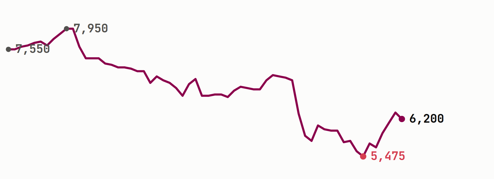
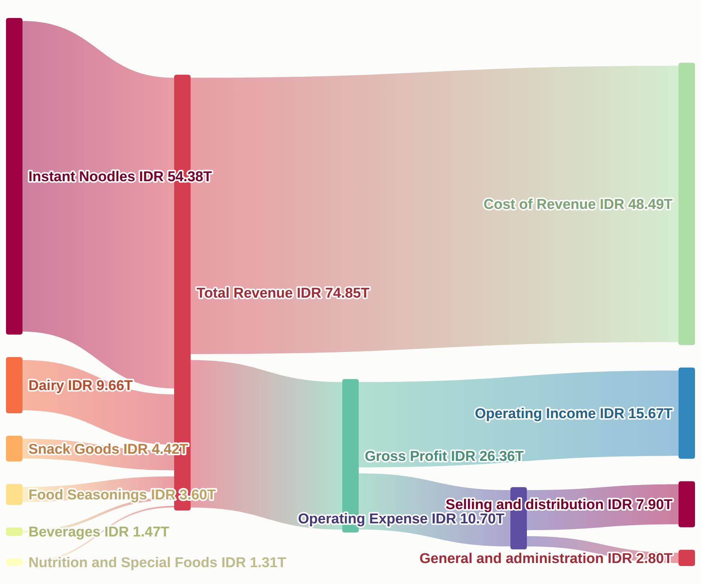
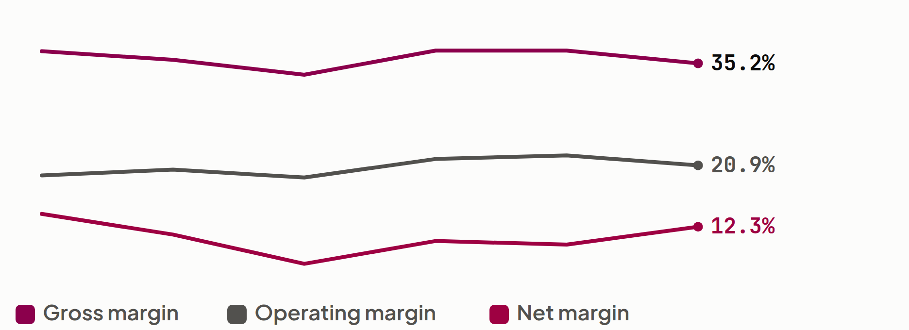

# [**ICBP**](https://sectors.app/idx/icbp?utm_source=newsletter&utm_medium=email&utm_campaign=single-company-deep-dive_2026-11-11&utm_content=headline&utm_term=icbp) Sales Rose 15% in Nine Months While Net Profit Fell 13%

Indofood CBP Sukses Makmur sells instant noodles, dairy and snacks to a mass market, and noodles alone supply nearly three quarters of its revenue. In the nine months to September 2026 sales grew quickly while profit attributable to owners shrank. Despite that gap, operating profit still rose and management lifted its full-year sales guidance.

**At a Glance**

- **Net profit:** Profit attributable to owners fell **-13.2%** to IDR 6.16T in nine months while sales rose **+15%** to IDR 64.45T (Fortune IDN, 2 Nov 2026).
- **Price:** [**ICBP**](https://sectors.app/idx/icbp?utm_source=newsletter&utm_medium=email&utm_campaign=single-company-deep-dive_2026-11-11&utm_content=at-a-glance&utm_term=icbp) closed at IDR 6,200 on 9 November, **-17.9%** since 12 August and **+13.2%** above its 30 October low of IDR 5,475.
- **Profitability:** 2025 gross margin of 35.2% against 37.0% in 2023, with return on equity at 12.5% against 18.9% in 2019.
- **Core business:** Instant noodles are 72.7% of 2025 revenue, IDR 54.38T of IDR 74.85T.
- **Open Question:** Do the currency losses on the company's dollar bonds reverse with the rupiah, or does a balance sheet carrying IDR 49.92T of debt keep claiming a share of profit as sales grow?

**PT Indofood CBP Sukses Makmur Tbk ([**ICBP**](https://sectors.app/idx/icbp?utm_source=newsletter&utm_medium=email&utm_campaign=single-company-deep-dive_2026-11-11&utm_content=company-card&utm_term=icbp))** | Last close IDR 6,200 | Market cap IDR 72.30T | Market cap rank 23rd

*The share price fell from IDR 7,950 on 27 August to IDR 5,475 on 30 October, then recovered to IDR 6,200 by 9 November.*

## Sales Guidance Went Up in the Same Print That Showed Lower Net Profit

[**ICBP**](https://sectors.app/idx/icbp?utm_source=newsletter&utm_medium=email&utm_campaign=single-company-deep-dive_2026-11-11&utm_content=why-now&utm_term=icbp)'s nine-month results arrived at the end of October with a split message. Management raised full-year sales growth guidance to 12% to 14% from 5% to 7% and kept the operating margin target at 20% to 22% (Investor.id, 3 Nov 2026).

Profit attributable to owners fell 13.2% to IDR 6.16T, yet core profit, which strips out currency differences and one-offs, rose 5% (Fortune IDN, 2 Nov 2026).

The shares closed at a 90 day low of IDR 5,475 on 30 October and gained 15.5% by 6 November. The price recovery and the results landed in the same week.

sectors.app has not yet loaded the third quarter statements, so every quarterly figure below runs to the second quarter and the nine-month numbers are company-reported.

## Instant Noodles Still Supply Nearly Three Quarters of Revenue

[**ICBP**](https://sectors.app/idx/icbp?utm_source=newsletter&utm_medium=email&utm_campaign=single-company-deep-dive_2026-11-11&utm_content=business&utm_term=icbp) is a packaged food maker whose sales come mostly from one product family, with the rest spread across four smaller ones.

*Of every IDR 100 of 2025 revenue, IDR 64.78 went to cost of revenue and IDR 20.93 reached operating income.*

| Product line | 2025 revenue | Share | Change vs 2023 |
|---|---|---|---|
| Instant noodles | IDR 54.38T | 72.7% | **+10.5%** |
| Dairy | IDR 9.66T | 12.9% | **+8.4%** |
| Snack goods | IDR 4.42T | 5.9% | **+7.4%** |
| Food seasonings | IDR 3.60T | 4.8% | **+27.2%** |
| Beverages | IDR 1.47T | 2.0% | **-8.5%** |
| Nutrition and special foods | IDR 1.31T | 1.8% | **+7.8%** |

Households buying noodles, milk products, snacks and seasonings are the customers, and seasonings are the fastest growing line over two years while still under 5% of sales. The group's growth rate is therefore set by noodles, which makes the recent acceleration notable: revenue grew 3.1% in 2025, and the company reports nine-month volume up 9% and average selling price up 5% in 2026 (Investor.id, 3 Nov 2026).

## Scale and Distribution Protect Sales, and Gross Margin Has Held a Narrow Band

The protection here is scale and a distribution network, and the test is whether margins held when costs rose.

[**ICBP**](https://sectors.app/idx/icbp?utm_source=newsletter&utm_medium=email&utm_campaign=single-company-deep-dive_2026-11-11&utm_content=moat&utm_term=icbp) has the largest market cap among the peers sectors.app lists for it. Its nearest independent rival by size, [**MYOR**](https://sectors.app/idx/myor?utm_source=newsletter&utm_medium=email&utm_campaign=single-company-deep-dive_2026-11-11&utm_content=moat&utm_term=myor), earns about a third of [**ICBP**](https://sectors.app/idx/icbp?utm_source=newsletter&utm_medium=email&utm_campaign=single-company-deep-dive_2026-11-11&utm_content=moat&utm_term=icbp)'s net profit and trades at a higher price-to-book (P/B) multiple, 1.59x against 1.37x. Selling and distribution is the largest operating cost line at 10.6% of 2025 revenue, which is the price of reaching retailers.

| Company | Market cap | 2025 net profit | P/E (TTM) | P/B |
|---|---|---|---|---|
| [**ICBP**](https://sectors.app/idx/icbp?utm_source=newsletter&utm_medium=email&utm_campaign=single-company-deep-dive_2026-11-11&utm_content=moat&utm_term=icbp) | IDR 72.30T | IDR 9.22T | 9.8x | 1.37x |
| [**INDF**](https://sectors.app/idx/indf?utm_source=newsletter&utm_medium=email&utm_campaign=single-company-deep-dive_2026-11-11&utm_content=moat&utm_term=indf) | IDR 60.37T | IDR 10.68T | 6.3x | 0.79x |
| [**MYOR**](https://sectors.app/idx/myor?utm_source=newsletter&utm_medium=email&utm_campaign=single-company-deep-dive_2026-11-11&utm_content=moat&utm_term=myor) | IDR 30.07T | IDR 2.87T | 8.7x | 1.59x |
| [**STTP**](https://sectors.app/idx/sttp?utm_source=newsletter&utm_medium=email&utm_campaign=single-company-deep-dive_2026-11-11&utm_content=moat&utm_term=sttp) | IDR 10.51T | IDR 1.18T | 8.5x | 1.33x |
| [**GOOD**](https://sectors.app/idx/good?utm_source=newsletter&utm_medium=email&utm_campaign=single-company-deep-dive_2026-11-11&utm_content=moat&utm_term=good) | IDR 10.33T | IDR 0.69T | 14.7x | 2.65x |

[**INDF**](https://sectors.app/idx/indf?utm_source=newsletter&utm_medium=email&utm_campaign=single-company-deep-dive_2026-11-11&utm_content=moat&utm_term=indf) is the group's parent and consolidates [**ICBP**](https://sectors.app/idx/icbp?utm_source=newsletter&utm_medium=email&utm_campaign=single-company-deep-dive_2026-11-11&utm_content=moat&utm_term=icbp), so the two are not independent competitors (Industry.co.id, 2 Nov 2026). Gross margin stayed between 33.6% and 37.0% from 2020 to 2025, a band of under four points through a period when the company reports rising input costs.

Returns tell a less flattering story. Return on equity (ROE), the profit earned on shareholder money, was 18.9% in 2019 and has stayed between 8.0% and 13.1% since 2020, the year the equity base nearly doubled. The moat has protected margins without lifting returns.

## Every IDR 100 of Sales Leaves IDR 12.30 in Net Profit

The business turns sales into operating profit steadily, and what sits below the operating line has decided the last two years of net profit.

*Gross and operating margin finished 2025 below their 2023 levels while net margin finished above it, so the 2025 gain in net margin came from below the operating line.*

| Ratio | 2023 | 2024 | 2025 |
|---|---|---|---|
| Gross margin | 37.0% | 37.0% | 35.2% |
| Operating margin | 21.8% | 22.3% | 20.9% |
| Net margin | 10.3% | 9.8% | 12.3% |
| Return on equity | 11.3% | 10.6% | 12.5% |
| Return on assets | 5.9% | 5.6% | 6.8% |
| Debt to equity | 0.92x | 0.88x | 0.84x |
| Interest coverage | 7.3x | 3.8x | 4.1x |
| Operating cash flow margin | 18.3% | 17.2% | 16.2% |

Operating profit slipped 3.2% in 2025 while net profit rose 30.3%.

In 2026 the pattern reversed. A non-operating loss of IDR 1.88T in the second quarter took net profit to IDR 1.13T from IDR 2.88T a year earlier.

Leverage ratios show a mixed picture. Debt to equity improved, but interest coverage, the number of times operating profit covers interest cost, is about half its 2023 level. Cash of IDR 33.54T covered two thirds of IDR 49.92T of total debt at the end of June 2026.

| Period | Revenue | Change | Net profit | Change |
|---|---|---|---|---|
| FY2023 | IDR 67.91T | **+4.8%** | IDR 6.99T | **+52.4%** |
| FY2024 | IDR 72.60T | **+6.9%** | IDR 7.08T | **+1.3%** |
| FY2025 | IDR 74.85T | **+3.1%** | IDR 9.22T | **+30.3%** |
| Q2 2026 | IDR 20.15T | **+15.7%** | IDR 1.13T | **-60.8%** |

*Annual rows compare with the prior year and the quarter compares with Q2 2025. Margins are gross profit and operating expenses as reported on sectors.app, so they differ from the company's own 21.2% nine-month operating margin.*

## The Weak Rupiah Reaches [**ICBP**](https://sectors.app/idx/icbp?utm_source=newsletter&utm_medium=email&utm_campaign=single-company-deep-dive_2026-11-11&utm_content=macro&utm_term=icbp) Through Its Dollar Bonds

Three outside forces reach this company's accounts, and the currency is the one that shows up in net profit.

**Rupiah.** The currency traded near 18,160 per dollar on 2 November and struggled to break below 18,000 for a second week (Trading Economics, 2 Nov 2026). Indofood's nine-month report attributes higher unrealized foreign exchange losses mainly to dollar bonds issued by [**ICBP**](https://sectors.app/idx/icbp?utm_source=newsletter&utm_medium=email&utm_campaign=single-company-deep-dive_2026-11-11&utm_content=macro&utm_term=icbp) (Industry.co.id, 2 Nov 2026), which land on the non-operating line.

**Interest rates.** Bank Indonesia raised rates by a cumulative 100 basis points in May and June (Trading Economics, 2 Nov 2026) and held the BI-Rate at 5.75% on 21 October (Bank Indonesia, 21 Oct 2026). Fortune IDN names higher finance costs as a reason net profit fell (2 Nov 2026).

**Input costs.** Raw material, packaging and logistics costs pushed the company's operating margin down 1.4 points to 21.2% in nine months (Investor.id, 3 Nov 2026), and they sit in cost of revenue, 64.8% of 2025 sales.

## [**ICBP**](https://sectors.app/idx/icbp?utm_source=newsletter&utm_medium=email&utm_campaign=single-company-deep-dive_2026-11-11&utm_content=read&utm_term=icbp) Now Trades at Roughly Half Its 2024 Earnings Multiple

The market is paying less for each rupiah of [**ICBP**](https://sectors.app/idx/icbp?utm_source=newsletter&utm_medium=email&utm_campaign=single-company-deep-dive_2026-11-11&utm_content=read&utm_term=icbp)'s earnings than it did two years ago, while still paying more than the [food and beverage](https://sectors.app/indonesia/food-beverage?utm_source=newsletter&utm_medium=email&utm_campaign=single-company-deep-dive_2026-11-11&utm_content=read) sub-sector median.

| Multiple | Latest | Sub-sector 2026 | ICBP 2022 to 2025 range |
|---|---|---|---|
| Price-to-earnings (P/E) | 9.8x | 7.7x | 10.4x to 25.4x |
| Price-to-book (P/B) | 1.37x | 1.52x | 1.30x to 2.03x |
| Price-to-sales | 0.91x | 0.87x | 1.28x to 1.83x |

*The sub-sector P/E is the median of 101 companies and the other two are sub-sector averages, all from sectors.app.*

The business earned IDR 15.67T at the operating line in 2025 on scale and distribution that have held gross margin in a narrow band. What changed is the line below it, where currency and finance costs have taken a growing share.

A dividend of IDR 265 a share went ex-dividend in July, a 4.3% yield against a five year average of 2.6%.

The counterargument is that the weakness sits below the operating line and the operating line is growing. Operating profit rose 7% on 15% more sales (Fortune IDN, 2 Nov 2026), guidance moved up, and the analyst revenue estimate for 2026 implies growth of 15.0% over 2025.

Of 72 analysts on sectors.app, 59 rate the shares buy and 13 hold, as of 3 November, and none rate them sell.

> **This leaves one open question: do the currency losses on [**ICBP**](https://sectors.app/idx/icbp?utm_source=newsletter&utm_medium=email&utm_campaign=single-company-deep-dive_2026-11-11&utm_content=read&utm_term=icbp)'s dollar bonds reverse if the rupiah recovers, or does a balance sheet carrying IDR 49.92T of debt keep claiming a share of profit even as sales grow?**

## What to Watch Next

- **Fourth quarter and full year 2026 results.** Nine-month sales growth of 15% sits above the raised 12% to 14% guidance, and the 20% to 22% operating margin range is the second guided reading to check.
- **The rupiah against 18,000 per dollar.** Unrealized losses on [**ICBP**](https://sectors.app/idx/icbp?utm_source=newsletter&utm_medium=email&utm_campaign=single-company-deep-dive_2026-11-11&utm_content=watch&utm_term=icbp)'s dollar bonds track the exchange rate, so the currency level in early November frames how large the next below-the-line charge could be.
- **Interest coverage.** The ratio was 4.1x in 2025 against 7.3x in 2023, and a return toward the 2023 level would show finance costs easing relative to operating profit.
- **Seasonings share of revenue.** The line grew 27.2% over two years to 4.8% of sales, and a share above 5% would be the first visible shift in a mix that has barely moved.

## Follow [**ICBP**](https://sectors.app/idx/icbp?utm_source=newsletter&utm_medium=email&utm_campaign=single-company-deep-dive_2026-11-11&utm_content=cta&utm_term=icbp) Into Its Next Print

Open the company report to work the segment, peer and ratio data yourself, or add it to a [watchlist](https://sectors.app/watchlist?utm_source=newsletter&utm_medium=email&utm_campaign=single-company-deep-dive_2026-11-11&utm_content=cta) to see new filings and results as they arrive.

[Read the ICBP company report](https://sectors.app/idx/icbp?utm_source=newsletter&utm_medium=email&utm_campaign=single-company-deep-dive_2026-11-11&utm_content=cta&utm_term=icbp)

**Sources**

- [Investor.id: PT Indofood CBP Sukses Makmur Tbk Raises FY26 Sales Growth Guidance to 12 to 14 Percent, 3 Nov 2026](https://investor.id/bond/460505/tangan-dingin-anthoni-salim)
- [Fortune IDN: Penjualan Indofood CBP Naik 15%, Biaya Produksi Tekan Margin, 2 Nov 2026](https://www.fortuneidn.com/business/penjualan-icbp-naik-15-biaya-produksi-tekan-margin-00-4pj81-1dd5zr)
- [Industry.co.id: Indofood Catat Penjualan Rp101,49 Triliun hingga September 2026, 2 Nov 2026](https://www.industry.co.id/read/158390/indofood-catat-penjualan-rp10149-triliun-hingga-september-2026-laba-usaha-tumbuh-15)
- [Trading Economics: Rupiah Fails to Gain Ground After October Inflation Data, 2 Nov 2026](https://tradingeconomics.com/indonesia/currency/news/597162)
- [Bank Indonesia: BI Rate Held at 5.75 percent, 21 Oct 2026](https://www.bi.go.id/en/iru/highlight-news/Pages/BI-Rate-Held-at-5.75-percent--Strengthening-Stability,-Supporting-Economic-Growth.aspx)

**Appendix: Sectors API endpoints (fields used)**
- `company/report/ICBP/`: overview.market_cap, overview.market_cap_rank, overview.last_close_price, overview.all_time_price, valuation.forward_pe, valuation.historical_valuation[], financials.historical_financials[], financials.historical_financial_ratio[], dividend.yield_ttm, dividend.dividend_ttm, dividend.payout_ratio, dividend.dividend_yield_avg, future.company_growth_forecasts, future.company_value_forecasts, future.analyst_rating_breakdown, peers[].peers_data.companies[]
- `company/get-segments/ICBP/`: revenue_breakdown[]
- `financials/quarterly/ICBP/`: revenue, earnings, operating_pnl, non_operating_income_or_loss, total_debt, cash_only
- `subsector/report/food-beverage/`: statistics.filtered_median_pe, statistics.total_companies, valuation.historical_valuation
- `daily/ICBP/`: close

---
*This newsletter is data reporting and market commentary, not investment advice or a recommendation to buy or sell any security. Figures are from sectors.app as of 9 November 2026 unless otherwise cited. Do your own research.*
