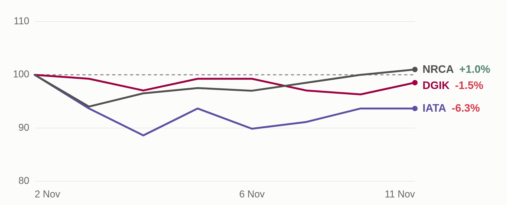

# Three Majority Holders Raised Their Stakes This Week

## The Three Filings

- [**DGIK**](https://sectors.app/idx/dgik?utm_source=newsletter&utm_medium=email&utm_campaign=three-stock-story_2026-11-12&utm_content=glance&utm_term=dgik) (Nusa Konstruksi Enjiniring): Global Dinamika Kencana filed three purchases dated 6, 9 and 10 November, all at IDR 135, lifting its stake from 52.30% to 62.40%. The 560.51 million shares cost IDR 75.67B.
- [**IATA**](https://sectors.app/idx/iata?utm_source=newsletter&utm_medium=email&utm_campaign=three-stock-story_2026-11-12&utm_content=glance&utm_term=iata) (MNC Energy Investments): Karya Pacific Investama bought 1.23 billion shares on 3 November at IDR 66, filed on 11 November, taking its stake from 62.47% to 66.40%. The purchase cost IDR 81.04B.
- [**NRCA**](https://sectors.app/idx/nrca?utm_source=newsletter&utm_medium=email&utm_campaign=three-stock-story_2026-11-12&utm_content=glance&utm_term=nrca) (Nusa Raya Cipta): Surya Semesta Internusa bought 14 million shares on 9 November at IDR 390, lifting its stake from 63.94% to 64.50%. The purchase cost IDR 5.46B.

## Why a Majority Holder's Buying Matters

**What it can signal.** A holder above 50% already decides every ordinary shareholder vote, so each extra share is more capital committed to a company it already steers. Holders sit close to contracts and cash flow, which makes repeated buying worth noting, though a single filing can also reflect a change in how shares are held.

**What it can change.** Each purchase takes shares away from other investors, so the portion held by everyone else shrinks. A smaller outside holding can mean thinner trading, and it can matter for resolutions that need more than a simple majority of votes.

> **The filings say who bought, how many shares and at what price. They do not say why, and they do not say what the share price will do next.**

---

## [**DGIK**](https://sectors.app/idx/dgik?utm_source=newsletter&utm_medium=email&utm_campaign=three-stock-story_2026-11-12&utm_content=dgik&utm_term=dgik): Controller Adds 10.10 Points Across Three Trades

**PT Nusa Konstruksi Enjiniring Tbk** ([**DGIK**](https://sectors.app/idx/dgik?utm_source=newsletter&utm_medium=email&utm_campaign=three-stock-story_2026-11-12&utm_content=dgik&utm_term=dgik)) | Last close **IDR 134** | Vs 52-week high **-35.0%** | Market cap **IDR 742.52B**

[**DGIK**](https://sectors.app/idx/dgik?utm_source=newsletter&utm_medium=email&utm_campaign=three-stock-story_2026-11-12&utm_content=dgik&utm_term=dgik) is a heavy construction and civil engineering contractor controlled by PT Global Dinamika Kencana, which held 52.30% before this week. The company announced a plan to transfer treasury shares to that holder just before the purchases began.

- **7 Mar 2022 to 19 Sep 2023:** [**DGIK**](https://sectors.app/idx/dgik?utm_source=newsletter&utm_medium=email&utm_campaign=three-stock-story_2026-11-12&utm_content=dgik&utm_term=dgik) buys back the 400,214,500 shares it now holds in treasury (EmitenNews, 4 Nov 2026).
- **18 Dec 2025:** The share price reaches its 52-week high of IDR 206.
- **4 Nov 2026:** The company announces that its controller may take up to those 400,214,500 treasury shares through the negotiated market, in one or several stages from 11 November to 31 December 2026 (EmitenNews, 4 Nov 2026).
- **6 Nov 2026:** Global Dinamika Kencana buys 106.61 million shares at IDR 135 for IDR 14.39B, taking its stake from 52.30% to 54.20%.
- **9 Nov 2026:** It buys 204.26 million shares at IDR 135 for IDR 27.58B, reaching 57.90%. Only 1.80 million [**DGIK**](https://sectors.app/idx/dgik?utm_source=newsletter&utm_medium=email&utm_campaign=three-stock-story_2026-11-12&utm_content=dgik&utm_term=dgik) shares traded on the market that day.
- **10 Nov 2026:** It buys 249.64 million shares at IDR 135 for IDR 33.70B, reaching 62.40%. The three purchases total 560.51 million shares, more than the 400.21 million treasury shares in the plan.
- **11 Nov 2026:** [**DGIK**](https://sectors.app/idx/dgik?utm_source=newsletter&utm_medium=email&utm_campaign=three-stock-story_2026-11-12&utm_content=dgik&utm_term=dgik) closes at IDR 134, **-35.0%** against its 52-week high.

Revenue has grown every year, from IDR 373.04B in 2022 to IDR 861.07B in 2025, and net profit from IDR 8.26B to IDR 54.25B. Net margin, the share of revenue kept as profit, peaked at 7.5% in 2024 and eased to 6.3% in 2025. Debt to equity rose from 0.45x in 2023 to 1.04x in 2025.

| Year | Revenue | Change | Net profit | Net margin |
|---|---|---|---|---|
| 2022 | IDR 373.04B | **+1.8%** | IDR 8.26B | 2.2% |
| 2023 | IDR 462.78B | **+24.1%** | IDR 25.15B | 5.4% |
| 2024 | IDR 644.56B | **+39.3%** | IDR 48.39B | 7.5% |
| 2025 | IDR 861.07B | **+33.6%** | IDR 54.25B | 6.3% |

> **Key takeaway.** The three filings total IDR 75.67B, which is 10.2% of the company's IDR 742.52B market value, and they move the controller's stake past 60%. Net margin slipped in 2025 while debt to equity passed 1.0x.

---

## [**IATA**](https://sectors.app/idx/iata?utm_source=newsletter&utm_medium=email&utm_campaign=three-stock-story_2026-11-12&utm_content=iata&utm_term=iata): Controller Keeps Buying After the MNC Group Exit

**PT MNC Energy Investments Tbk** ([**IATA**](https://sectors.app/idx/iata?utm_source=newsletter&utm_medium=email&utm_campaign=three-stock-story_2026-11-12&utm_content=iata&utm_term=iata)) | Last close **IDR 74** | Vs 52-week high **-62.6%** | Market cap **IDR 2.31T**

[**IATA**](https://sectors.app/idx/iata?utm_source=newsletter&utm_medium=email&utm_campaign=three-stock-story_2026-11-12&utm_content=iata&utm_term=iata) is an oil, gas and coal company. Karya Pacific Investama holds a majority, and MNC Asia Holding has sold its entire stake.

- **11 Dec 2025:** Karya Pacific Investama buys at IDR 100 for IDR 125.94B, lifting its stake from 44.76% to 48.79%.
- **28 Jul 2026:** MNC Asia Holding sells its last 1.78 billion shares at IDR 60 and holds none afterwards. Karya Pacific Investama buys 1.56 billion shares at IDR 60 the same day (EmitenNews, 12 Aug 2026).
- **6 Aug 2026:** Karya Pacific Investama buys 1.51 billion shares at IDR 90. Across the two trades its stake rises from 50.50% to 60.35%, for IDR 230.35B (EmitenNews, 12 Aug 2026).
- **8 Sep 2026:** [**IATA**](https://sectors.app/idx/iata?utm_source=newsletter&utm_medium=email&utm_campaign=three-stock-story_2026-11-12&utm_content=iata&utm_term=iata) closes at IDR 143, its highest close of the last 90 days.
- **3 Nov 2026:** Karya Pacific Investama buys 1.23 billion shares at IDR 66 for IDR 81.04B, reaching 66.40%. The price sits below that day's low of IDR 74, and 121.79 million shares traded on the market, so the purchase did not go through the regular market.
- **11 Nov 2026:** [**IATA**](https://sectors.app/idx/iata?utm_source=newsletter&utm_medium=email&utm_campaign=three-stock-story_2026-11-12&utm_content=iata&utm_term=iata) closes at IDR 74, **-62.6%** against its 52-week high and **-48.3%** against the 8 September close.

Revenue has fallen every year, from IDR 2.99T in 2022 to IDR 1.33T in 2025, and net profit from IDR 607.41B to IDR 127.38B. The 2025 profit was 2.7% above 2024's IDR 124.04B, with a net margin of 9.6% and an ROE, profit earned on shareholder money, of 5.6%. Debt to equity eased from 1.38x in 2023 to 0.77x in 2025.

| Year | Revenue | Change | Net profit | Net margin |
|---|---|---|---|---|
| 2022 | IDR 2.99T | n/a | IDR 607.41B | 20.3% |
| 2023 | IDR 2.63T | **-12.3%** | IDR 407.26B | 15.5% |
| 2024 | IDR 1.90T | **-27.5%** | IDR 124.04B | 6.5% |
| 2025 | IDR 1.33T | **-30.0%** | IDR 127.38B | 9.6% |

*The 2022 change of +1,869.6% is omitted as an outlier.*

> **Key takeaway.** The IDR 81.04B purchase is 3.5% of the company's IDR 2.31T market value and lifts the controller to 66.40%. Revenue has shrunk for three straight years, and the share price has fallen to about half its September close.

---

## [**NRCA**](https://sectors.app/idx/nrca?utm_source=newsletter&utm_medium=email&utm_campaign=three-stock-story_2026-11-12&utm_content=nrca&utm_term=nrca): Parent Tops Up a 64% Stake With a Small Block

**PT Nusa Raya Cipta Tbk** ([**NRCA**](https://sectors.app/idx/nrca?utm_source=newsletter&utm_medium=email&utm_campaign=three-stock-story_2026-11-12&utm_content=nrca&utm_term=nrca)) | Last close **IDR 406** | Vs 52-week high **-81.2%** | Market cap **IDR 1.01T**

[**NRCA**](https://sectors.app/idx/nrca?utm_source=newsletter&utm_medium=email&utm_campaign=three-stock-story_2026-11-12&utm_content=nrca&utm_term=nrca) is a building contractor and a subsidiary of PT Surya Semesta Internusa Tbk ([**SSIA**](https://sectors.app/idx/ssia?utm_source=newsletter&utm_medium=email&utm_campaign=three-stock-story_2026-11-12&utm_content=nrca&utm_term=ssia)), which held 63.94% before this filing. The investment company Saratoga Investama Sedaya ([**SRTG**](https://sectors.app/idx/srtg?utm_source=newsletter&utm_medium=email&utm_campaign=three-stock-story_2026-11-12&utm_content=nrca&utm_term=srtg)) holds a further 5.98%.

- **15 Dec 2025:** The share price reaches its 52-week high of IDR 2,160.
- **19 Dec 2025:** Executive Eddy Purwana Wikanta sells at IDR 2,031.27 for IDR 4.47B, trimming his stake from 2.46% to 2.37%.
- **19 Jan 2026:** [**SRTG**](https://sectors.app/idx/srtg?utm_source=newsletter&utm_medium=email&utm_campaign=three-stock-story_2026-11-12&utm_content=nrca&utm_term=srtg) sells at IDR 1,218 for IDR 913.5 million, moving from 6.02% to 5.99%.
- **6 Aug 2026:** [**SSIA**](https://sectors.app/idx/ssia?utm_source=newsletter&utm_medium=email&utm_campaign=three-stock-story_2026-11-12&utm_content=nrca&utm_term=ssia) reports first half results for its construction unit: revenue flat at IDR 1,700.2B, net profit up 21.5% to IDR 93.0B and new contracts of IDR 1,370.9B (Kabar Bursa, 6 Aug 2026).
- **17 Sep 2026:** [**NRCA**](https://sectors.app/idx/nrca?utm_source=newsletter&utm_medium=email&utm_campaign=three-stock-story_2026-11-12&utm_content=nrca&utm_term=nrca) closes at IDR 610, its highest close of the last 90 days.
- **3 Nov 2026:** [**NRCA**](https://sectors.app/idx/nrca?utm_source=newsletter&utm_medium=email&utm_campaign=three-stock-story_2026-11-12&utm_content=nrca&utm_term=nrca) closes at IDR 378, its lowest close of the last 90 days.
- **9 Nov 2026:** [**SSIA**](https://sectors.app/idx/ssia?utm_source=newsletter&utm_medium=email&utm_campaign=three-stock-story_2026-11-12&utm_content=nrca&utm_term=ssia) buys 14 million shares at IDR 390 for IDR 5.46B, reaching 64.50%. The market traded 1.21 million [**NRCA**](https://sectors.app/idx/nrca?utm_source=newsletter&utm_medium=email&utm_campaign=three-stock-story_2026-11-12&utm_content=nrca&utm_term=nrca) shares that day.
- **11 Nov 2026:** [**NRCA**](https://sectors.app/idx/nrca?utm_source=newsletter&utm_medium=email&utm_campaign=three-stock-story_2026-11-12&utm_content=nrca&utm_term=nrca) closes at IDR 406, **-81.2%** against its 52-week high.

Revenue grew from IDR 2.46T in 2022 to IDR 3.61T in 2025, with 2025 up 7.1%. Net profit more than doubled in 2025 to IDR 175.52B from IDR 81.60B, lifting net margin to 4.9% and ROE to 12.8%. Debt to equity stood at 1.13x.

| Year | Revenue | Change | Net profit | Net margin |
|---|---|---|---|---|
| 2022 | IDR 2.46T | **+47.5%** | IDR 74.67B | 3.0% |
| 2023 | IDR 2.90T | **+17.6%** | IDR 99.51B | 3.4% |
| 2024 | IDR 3.37T | **+16.5%** | IDR 81.60B | 2.4% |
| 2025 | IDR 3.61T | **+7.1%** | IDR 175.52B | 4.9% |

> **Key takeaway.** The IDR 5.46B purchase is 0.54% of the company's IDR 1.01T market value and moves the parent's stake by 0.56 points. The 2025 profit doubled, and the share price still sits 81.2% below its December high.

---

## Share Prices Since 2 November

From the 2 November close to 11 November, [**NRCA**](https://sectors.app/idx/nrca?utm_source=newsletter&utm_medium=email&utm_campaign=three-stock-story_2026-11-12&utm_content=prices&utm_term=nrca) rose **+1.0%**, [**DGIK**](https://sectors.app/idx/dgik?utm_source=newsletter&utm_medium=email&utm_campaign=three-stock-story_2026-11-12&utm_content=prices&utm_term=dgik) fell **-1.5%** and [**IATA**](https://sectors.app/idx/iata?utm_source=newsletter&utm_medium=email&utm_campaign=three-stock-story_2026-11-12&utm_content=prices&utm_term=iata) fell **-6.3%**.

*Closing prices rebased to 100 at the 2 November close, 8 trading days to 11 November (sectors.app).*

---

### Follow [**DGIK**](https://sectors.app/idx/dgik?utm_source=newsletter&utm_medium=email&utm_campaign=three-stock-story_2026-11-12&utm_content=cta&utm_term=dgik), [**IATA**](https://sectors.app/idx/iata?utm_source=newsletter&utm_medium=email&utm_campaign=three-stock-story_2026-11-12&utm_content=cta&utm_term=iata) and [**NRCA**](https://sectors.app/idx/nrca?utm_source=newsletter&utm_medium=email&utm_campaign=three-stock-story_2026-11-12&utm_content=cta&utm_term=nrca) on Your Watchlist

Add them to a [watchlist](https://sectors.app/watchlist?utm_source=newsletter&utm_medium=email&utm_campaign=three-stock-story_2026-11-12&utm_content=cta) on sectors.app to see new insider filings and results as they come in.

[Build your watchlist](https://sectors.app/watchlist?utm_source=newsletter&utm_medium=email&utm_campaign=three-stock-story_2026-11-12&utm_content=cta)

## Sources

- EmitenNews, 4 Nov 2026: GDK Siap Serap Saham Buyback DGIK hingga Akhir Desember 2026: https://emitennews.com/news/gdk-siap-serap-saham-buyback-dgik-hingga-akhir-desember-2026
- EmitenNews, 12 Aug 2026: Tinggalkan Grup MNC, Karya Investama Angkut 3,08 Miliar Saham IATA: https://emitennews.com/news/tinggalkan-grup-mnc-karya-investama-angkut-308-miliar-saham-iata
- Kabar Bursa, 6 Aug 2026: Laba SSIA Berbalik Positif di Semester I 2026, Ini Motor Pertumbuhannya: https://www.kabarbursa.com/market-hari-ini/laba-ssia-berbalik-positif-di-semester-i-2026-ini-motor-pertumbuhannya

**Appendix: Sectors API endpoints (fields used)**
- `filings/` : `symbol`, `holder_name`, `transaction_type`, `price`, `amount_transaction`, `transaction_value`, `share_percentage_before`, `share_percentage_after`, `timestamp`
- `company/report/<TICKER>/` : `overview.last_close_price`, `overview.market_cap`, `overview.all_time_price`, `ownership.major_shareholders[]`, `financials.historical_financials[]`, `financials.historical_financial_ratio[]`
- `daily/<TICKER>/` : `date`, `close`, `volume`

---
*This newsletter is data reporting and market commentary, not investment advice or a recommendation to buy or sell any security. Figures are from sectors.app as of 11 November 2026 unless otherwise cited. Do your own research.*
